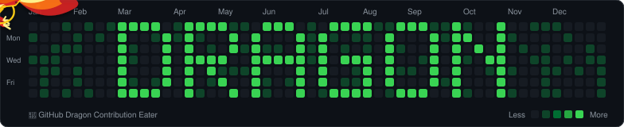

<p align="center">
  
</p>

<p align="center">
  
</p>

<p align="center">
  <a href="https://github.com/sansukumar22j24-hash"></a>
  <a href="https://github.com/sansukumar22j24-hash?tab=repositories"></a>
  
</p>

```text
███████╗ █████╗ ███╗   ██╗███████╗██╗   ██╗    ██╗  ██╗██╗   ██╗███╗   ███╗ █████╗ ██████╗ 
██╔════╝██╔══██╗████╗  ██║██╔════╝██║   ██║    ██║ ██╔╝██║   ██║████╗ ████║██╔══██╗██╔══██╗
███████╗███████║██╔██╗ ██║███████╗██║   ██║    █████╔╝ ██║   ██║██╔████╔██║███████║██████╔╝
╚════██║██╔══██║██║╚██╗██║╚════██║██║   ██║    ██╔═██╗ ██║   ██║██║╚██╔╝██║██╔══██║██╔══██╗
███████║██║  ██║██║ ╚████║███████║╚██████╔╝    ██║  ██╗╚██████╔╝██║ ╚═╝ ██║██║  ██║██║  ██║
╚══════╝╚═╝  ╚═╝╚═╝  ╚═══╝╚══════╝ ╚═════╝     ╚═╝  ╚═╝ ╚═════╝ ╚═╝     ╚═╝╚═╝  ╚═╝╚═╝  ╚═╝
                                                                                           
```

---

##  Hey there! I'm **SansuKumar**


- 🔭 I'm currently working on **[CourseManagementSystem](https://github.com/sansukumar22j24-hash/CourseSystemApp)**
- 🌱 I'm currently learning **Java, Spring, Spring Boot, Flask, FastAPI**
- 🤝 I'm looking to collaborate on **[CourseSystemApp](https://github.com/sansukumar22j24-hash/CourseSystemApp)**
- 💬 Ask me about **HTML, CSS, Tailwind, React**
- 🧠 I love building **backend systems, REST APIs & databases**
- 📫 How to reach me: **[sansukumar.22j24@kprcas.ac.in](mailto:sansukumar.22j24@kprcas.ac.in)**
- ⚡ Fun fact: **Overthinker about inventions**
- 🇮🇳 India

<br clear="right"/>

---

##  Tech Stack

**Languages**

<p align="center">
  
</p>

**Frameworks & Libraries**

<p align="center">
  
</p>

**Databases, ML & Tools**

<p align="center">
  
</p>

---

##  Featured Projects

<table>
  <tr>
    <td align="center"><a href="https://github.com/sansukumar22j24-hash/CourseSystemApp"></a></td>
    <td align="center"><a href="https://github.com/sansukumar22j24-hash/AI-website_builder"></a></td>
  </tr>
  <tr>
    <td align="center"><a href="https://github.com/sansukumar22j24-hash/Gridgaurd_DOTcoders"></a></td>
    <td align="center"><a href="https://github.com/sansukumar22j24-hash/HospitalManagementSystem"></a></td>
  </tr>
</table>

<p align="center">
  👉 <b><a href="https://github.com/sansukumar22j24-hash?tab=repositories">See all 25 repositories →</a></b>
</p>

---

##  GitHub Stats

<p align="center">
  
  
</p>

<p align="center">
  
</p>

<p align="center">
  
</p>

---

## 🖥️ Terminal Mode

<p align="center">
  
</p>

<details>
  <summary>📊 open the full tmux dashboard</summary>

  <p align="center">
    
  </p>

  <p align="center"><sub>profile · stats · streak · 26-week graph · languages — one terminal window.</sub></p>
</details>

<p align="center"><sub><code>$ neofetch --github sansukumar22j24-hash</code> — live ASCII, typed out on load.</sub></p>

---

## 🐉 My Contribution Dragon

<p align="center">
  
</p>

<p align="center"><sub>A fire-breathing dragon racing across the contribution grid.</sub></p>

---

## 🎌 Anime I'd Pause a Deploy For

<p align="center">
  <a href="https://giphy.com/gifs/cinema-absolute-tutturu-YE7L8pUvL1b8r8jgIb"></a>
  &nbsp;&nbsp;
  <a href="https://giphy.com/gifs/code-geass-lelouch-13pHvqbNfjaZyg"></a>
</p>

<p align="center"><sub>Steins;Gate · Code Geass — my overthinking, curated.</sub></p>

<details>
  <summary>✦ my neighbor totoro (ascii)</summary>

```text
            !         !
           ! !       ! !
          ! . !     ! . !
             ^^^^^^^^^ ^
           ^             ^
         ^  (0)       (0)  ^
        ^        ""         ^
       ^   ***************    ^
     ^   *                 *   ^
    ^   *   /\   /\   /\    *    ^
   ^   *                     *    ^
  ^   *   /\   /\   /\   /\   *    ^
 ^   *                         *    ^
^  *                           *   ^
^  *                           *   ^
 ^ *                           *  ^
  ^*                           * ^
   ^ *                        * ^
    ^  *                      *  ^
      ^  *       ) (         * ^
         ^^^^^^^^ ^^^^^^^^^
```

<p align="center"><sub>“Totoro” by Mabel Mak, from Christopher Johnson's ASCII Art Collection — <a href="https://asciiart.website/art/827">asciiart.website/art/827</a></sub></p>

</details>

---

##  Connect With Me

<p align="center">
  <a href="https://www.linkedin.com/in/div-bca-a6306138a" title="LinkedIn">
    
  </a>
  &nbsp;&nbsp;
  <a href="mailto:sansukumar.22j24@kprcas.ac.in" title="Email">
    
  </a>
  &nbsp;&nbsp;
  <a href="https://leetcode.com/u/1ewzRwEl7W/" title="LeetCode">
    
  </a>
</p>

<p align="center"><i>💬 Ask me anything about backend development — I don't bite, I only overthink.</i></p>

<p align="center">
  
</p>

<p align="center"></p>
